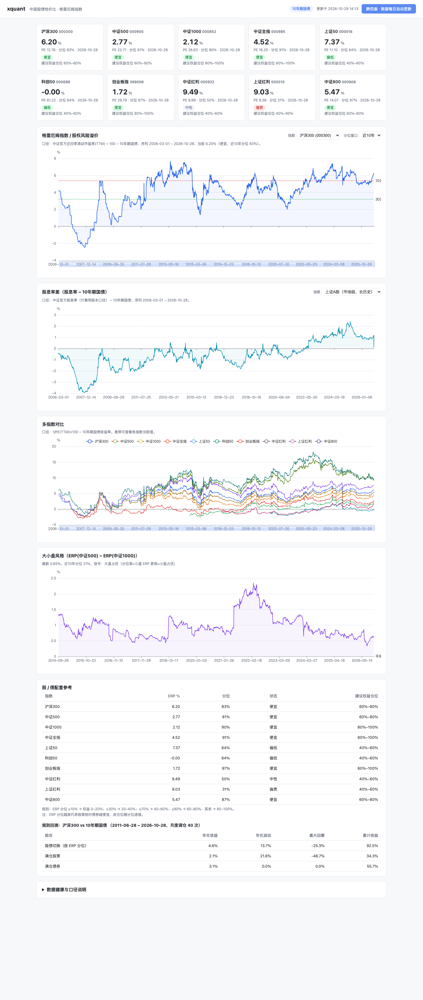

# xquant · 中国股债性价比仪表盘

本地运行的 Web 仪表盘：**格雷厄姆指数（ERP）**、**股息率差**、历史分位温度、大小盘风格利差、股/债配置参考。

覆盖指数：沪深300、中证500、中证1000、中证全指、上证50、科创50、创业板指、中证红利、上证红利、中证800。



## 在线查看（GitHub Pages）

**https://lovehin.github.io/xquant/**

静态版：数据在每个交易日 16:30 由 GitHub Actions 抓取后预生成成 `bundle.js` 并自动部署，只读、无需后端。
本地版（`xquant.cli serve`）多一个「刷新数据」按钮，可随时手动抓取。

## 快速开始

```bash
uv venv --python 3.12 .venv
uv pip install --python .venv/bin/python -r requirements.txt
.venv/bin/python -m xquant.cli update      # 首次抓数约 3-4 分钟，之后增量约 40 秒
.venv/bin/python -m xquant.cli serve       # 打开 http://127.0.0.1:8848
```

没有 `uv` 的话用标准库 venv：

```bash
python3.12 -m venv .venv
.venv/bin/python -m pip install -r requirements.txt
```

## 指标口径

| 指标 | 定义 |
|---|---|
| 格雷厄姆指数 / ERP | `1/PE(TTM)×100 − 10年期国债收益率` |
| ERP 分位 | ERP 在近 3/5/10 年或全历史中的分位（0-100），中位秩法，样本 < 60 时不给值 |
| 股息率差 | `指数股息率 − 10年期国债收益率` |
| 风格利差 | `ERP(中证500) − ERP(中证1000)`，取分位判定大小盘风格 |
| 配置参考 | ERP 分位 → 建议权益仓位区间（规则映射，见 `xquant/config.py` 的 `ALLOCATION_MAP`） |
| 规则回测 | 按上述映射在沪深300 与 10Y 国债间月度切换，对比满仓股票 / 满仓债券 |

## 数据源

| 数据 | 来源 | 频率 / 历史 |
|---|---|---|
| 指数 PE(TTM)、收盘价 | 中证指数 `index-perf`（`peg` 字段即官方近四季滚动市盈率） | 日 / 2005→ |
| 指数市盈率与股息率（总股本 / 计算用股本两种口径） | 中证指数 `indicator.xls` | 日 / 近 20 日窗口，逐日累积 |
| 国债与信用债收益率曲线 | 中国债券信息网（中债） | 日 / 2006→ |
| 指数 PE 周频、当前估值快照 | 蛋卷基金 | 周 / 2016→ |
| 沪深300 股债利差、宽基 PE 月频、市场股息率 | 乐咕乐股 | 日 / 月，2005→ |

主 PE 口径为**中证官方「近四季滚动市盈率」**（已与 CEIC 同口径序列交叉验证）；其余来源用于长历史补齐与交叉校验。

## 数据发布与每日更新

发布产物是两个文本文件（进版本库，git delta 极小）：

- `data/series.csv` — 各指数 ERP / 股息率差、风格利差、债券基准收益率、回测行情
- `data/snapshot.json` — 当前值、分位、配置建议、数据健康

本地抓取缓存 `data/market.db` 不进版本库。服务端启动时若发现 `series.csv` 比库里新，会自动导入。

- **GitHub Actions**（主方案）：`.github/workflows/update.yml`，交易日北京时间 16:30 抓数并提交 `data/`。首次使用需把本仓库推到你自己的 GitHub 仓库。
- **本机 launchd**（备选）：`bash scripts/install_launchd.sh`
- **手动刷新**：页面右上角「刷新数据」按钮，或 `.venv/bin/python -m xquant.cli update`
- **GitHub Pages**：workflow 的 `deploy-pages` job 会用最新数据构建静态站并部署（只读）

## 目录结构

```
xquant/config.py     指数清单、债券基准、仓位映射
xquant/sources/      各数据源适配器（中证 / 中债 / 蛋卷 / 乐咕）
xquant/store.py      SQLite 持久层
xquant/bundle.py     发布产物读写（series.csv ↔ 库）
xquant/metrics.py    指标纯函数
xquant/pipeline.py   抓取→落库→指标→发布
xquant/server.py     FastAPI
xquant/cli.py        命令行
web/                 单页前端（ECharts 本地 vendor，不依赖 CDN；支持 API / 静态双模式）
xquant/static_site.py  GitHub Pages 静态版构建（预生成 bundle.js）
tests/               pytest 单测（53 个）
```

## 常用命令

```bash
.venv/bin/python -m xquant.cli update          # 抓数 + 算指标 + 发布
.venv/bin/python -m xquant.cli update --no-network   # 只用已有数据重算
.venv/bin/python -m xquant.cli serve --port 8848
.venv/bin/python -m xquant.cli export          # 重算指标 + 导出发布产物
.venv/bin/python -m xquant.cli static          # 构建 GitHub Pages 静态站点到 site/
.venv/bin/python -m xquant.cli status          # 查看各数据源状态
.venv/bin/python -m xquant.cli backfill        # 回填中证 PE 日频历史
.venv/bin/python -m pytest -q                  # 跑测试
```

## 已知限制

- 股息率历史较短：中证只提供近 20 日窗口，指数级股息率序列从 2026-10-22 起累积；市场级（上证A股/深证A股/创业板/科创板）股息率有 2005→ 的长历史，可作替代视角。
- 创业板指（399006）属深证系，中证无数据，用蛋卷周频 PE（2016→）前值填充。
- 各家 PE 方法不同（中证/蛋卷/乐咕），本项目固定用中证官方口径做主序列，其余仅作校验与长历史补齐。
- 配置建议为固定规则映射，**不构成投资建议**。
